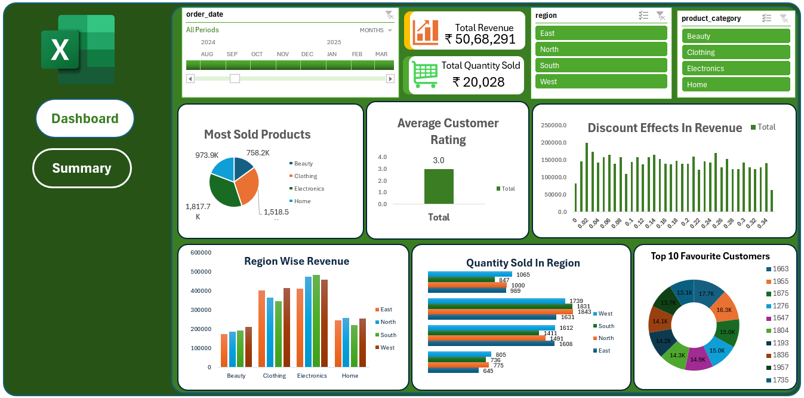

# E-Commerce Sales Analysis

An interactive Excel dashboard that analyses e-commerce sales across regions, product categories and customers.

## Key Figures
- **Total Revenue:** ₹50,68,291
- **Total Quantity Sold:** 20,028 units

## What the Dashboard Shows
- Most sold products by category
- Average customer rating
- Effect of discounts on revenue
- Region-wise revenue
- Quantity sold in each region
- Top 10 favourite customers

## Filters
- Order date (timeline)
- Region: East, North, South, West
- Product category: Beauty, Clothing, Electronics, Home

## Tools Used
- Microsoft Excel (charts and slicers)

## Files
- `E COMMERCE SALES ANALYSIS part 1.xlsx` – the Excel workbook with the Dashboard and Summary sheets

## Author
**Mohammed Irfan K P**
Data Analytics fresher | Malappuram, Kerala, India
GitHub: [mhmdirfankp456](https://github.com/mhmdirfankp456)
